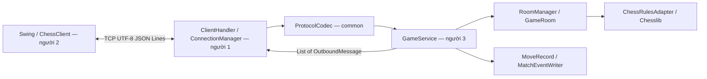
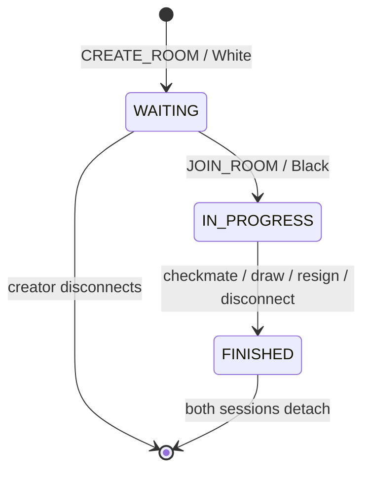

# Kiến trúc và ghép code phần 3

## Luồng xử lý



`common` chỉ chứa envelope/codec và phụ thuộc Jackson. `server` phụ thuộc `common`, Chesslib, SLF4J/Logback.
`client` phụ thuộc `common`; engine luật cờ chỉ tồn tại phía Server.
Server quyết định màu, quyền đi, lượt và kết quả. Client gửi yêu cầu và chờ snapshot.

## Điểm nối cho người 1

Khởi tạo **một** `GameService` dùng chung cho toàn bộ kết nối của một Server:

```java
GameService gameService = new GameService();
ProtocolCodec codec = new ProtocolCodec();
```

Với một dòng đã được bộ đọc có giới hạn lấy từ socket:

```java
Message request = codec.decode(line);
List<OutboundMessage> responses = gameService.handle(sessionId, request);
```

Mỗi `OutboundMessage` có getter `getRecipientSessionId()` và `getMessage()`.
Các hàm cũ `recipientSessionId()` và `message()` vẫn được giữ để tương thích.
`ConnectionManager` tìm kết nối theo session, rồi ghi `codec.encode(message)` bằng UTF-8 và flush.
`encode` đã có LF. Không ghi riêng từng byte từ nhiều thread hoặc dùng `println` làm thêm dòng trắng.

`Message` hiện là class thường, dùng getter `getType()`, `getRequestId()`, `getRoomId()`, `getPayload()`.
Constructor và các hàm cũ `type()`, `requestId()`, `roomId()`, `payload()` vẫn hoạt động.
`MoveRecord` cũng hỗ trợ cả getter và cách gọi cũ. Tên lệnh, tên field và cấu trúc JSON không đổi.

`GameService` dùng if/else và mỗi lệnh có một hàm `handle...()` riêng.
`GameRequestReader` đọc/kiểm tra JSON đầu vào; `GameResponseBuilder` tạo JSON đầu ra;
`GameEventLogger` ghi game event. [Hướng dẫn đọc code](reading-guide.md).

Khi EOF/timeout/lỗi I/O, dừng đọc session đó và gọi:

```java
List<OutboundMessage> notifications = gameService.onDisconnect(sessionId);
```

Gửi các thông báo cho session còn sống. Hàm disconnect gọi lặp lại được; một lần rớt kết nối chỉ kết thúc ván một lần.
Người 1 quản lý `SessionContext`/raw socket; phần 3 chỉ nhận `String sessionId` (1–128 ký tự `[A-Za-z0-9._:-]`) do Server gán, khác nhau giữa các kết nối.
Không tái sử dụng session ID và không đọc session ID từ JSON Client.

## Đồng thời và thứ tự

- Mỗi `GameRoom` có khóa riêng. Kiểm tra lượt, apply engine, thêm history, tạo snapshot và ghi event diễn ra dưới cùng khóa.
- Tạo/vào/rời phòng lấy khóa `rooms` rồi khóa `room`, giữ đến khi chuẩn bị xong trạng thái và phản hồi.
- Với MOVE/RESIGN/GET_STATE, `getRoom()` chỉ lấy khóa quản lý để tìm phòng, nhả khóa rồi mới khóa phòng để xử lý. Các nước đi ở phòng khác nhau dùng khóa phòng riêng.
- Bên trong khóa phòng, `requireMember()` chỉ đọc ConcurrentHashMap. Không lấy khóa quản lý sau khi đã lấy khóa phòng; điều này tránh hai luồng chờ khóa ngược nhau. JOIN/DISCONNECT đã giữ khóa quản lý từ bên ngoài.
- Mỗi session có một luồng đọc theo thứ tự. Cleanup chỉ chạy sau khi luồng đọc session đó đã dừng.
- Không gọi I/O socket trong khóa phòng. Kết quả trả về là danh sách thông điệp với payload đã sao chép.
- Người 1 cần hàng đợi gửi/khóa writer theo kết nối và cơ chế giữ thứ tự event trong phòng khi nhiều thread dispatch. `version` giúp Client bỏ snapshot cũ; khóa nghiệp vụ không tự bảo đảm thứ tự ghi TCP sau khi hàm đã trả về.
- Không dùng một `GameService` riêng cho mỗi Client vì như vậy hai Client sẽ không chia sẻ danh sách phòng.

## Vòng đời phòng



Chỉ hai người mỗi phòng; không spectator. Phòng kết thúc vẫn đọc được bằng `GET_STATE` cho thành viên còn gắn với phòng.
Tạo/vào phòng mới sau khi kết thúc sẽ gỡ membership cũ; phòng không còn thành viên sẽ bị xóa. `matchId` UUID giữ archive độc lập với mã phòng.
Không có database, khôi phục trạng thái sau Server restart hay reconnect/resume trong phiên bản này.

## Điểm nối cho người 2

1. Gửi `CREATE_ROOM`/`JOIN_ROOM`, giữ `roomId` và `matchId` Server trả về.
2. Lấy màu từ `yourColor`; render bàn cờ từ `fen`.
3. Click tạo UCI `MOVE`; chỉ xác nhận khi nhận `STATE` mới.
4. Hiển thị lịch sử theo `uci`, ghép theo `(matchId, ply)`, có thể lấy đủ lịch sử bằng `GET_STATE` phân trang.
5. Xử lý `MOVE_REJECTED`, `OPPONENT_DISCONNECTED`, `GAME_END`; không tự suy ra lượt/kết quả.
6. Cập nhật UI bằng `SwingUtilities.invokeLater`; TCP I/O chạy ở thread nền.

## Kiểm thử tích hợp hiện tại

`GameServiceTcpIntegrationTest` có **TCP harness chỉ dành cho test**, dùng socket loopback và hai client giả lập để kiểm tra codec/service/routing/EOF.
Harness này không thay thế production Server, không có giới hạn framing/timeout/shutdown đầy đủ của phần 1.
Demo Swing, hai máy LAN, Docker và tải nhiều kết nối phải làm sau khi ghép phần 1 và 2.
